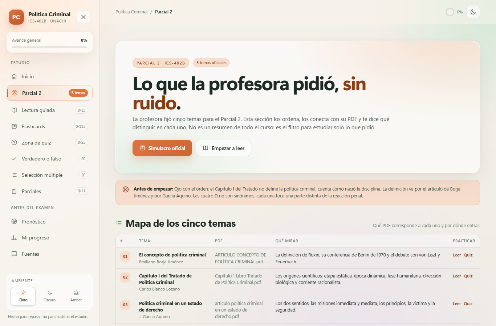
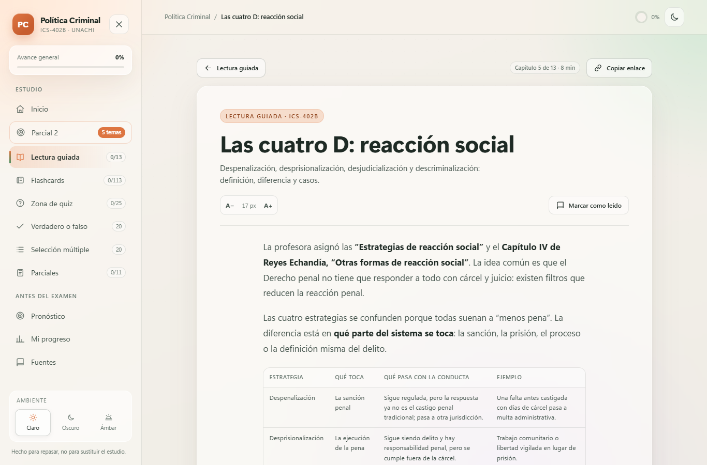

# Política Criminal · ICS-402B

Sitio web de estudio para el parcial de **Política Criminal (ICS-402B, UNACHI)**. Reúne lectura guiada, flashcards, quizzes y simulacros de parcial en una sola página, con diseño claro, modo oscuro y modo ámbar para leer de noche. Incluye una ruta específica con los **cinco temas oficiales del Parcial 2**.

**Sitio publicado:** https://magdalenagonzalez08.github.io/politica-criminal-ics402b/

[](https://magdalenagonzalez08.github.io/politica-criminal-ics402b/)

## Qué incluye

| Sección | Contenido |
| --- | --- |
| Parcial 2 | Mapa de los cinco temas, fichas, casos y plan de 60 minutos |
| Lectura guiada | 13 capítulos con ideas clave, artículos, cifras y fuentes |
| Flashcards | 11 mazos y 113 tarjetas para preguntarte y voltear |
| Zona de quiz | 25 quizzes de 5 preguntas |
| Verdadero o falso | 20 afirmaciones |
| Selección múltiple | 20 preguntas |
| Parciales | 10 simulacros de 10 preguntas y un parcial oficial de 20, con cronómetro |
| Pronóstico | Los cinco temas del Parcial 2, ordenados por peso y formato |
| Mi progreso | Resultados guardados en el navegador |

En total, **285 preguntas** y **113 tarjetas** de estudio.

### Ruta del Parcial 2



### Lectura cómoda



## Cómo usarlo

1. Abre el [sitio publicado](https://magdalenagonzalez08.github.io/politica-criminal-ics402b/).
2. Usa el menú lateral para elegir una sección. Si tu examen es el Parcial 2, entra a **Modo Parcial 2**.
3. Empieza por **Lectura guiada** o **Flashcards** si quieres estudiar sin presión.
4. Haz los quizzes y el simulacro oficial para medirte.
5. Revisa **Mi progreso** para ver qué te falta.

Atajos útiles:

- En las flashcards: **Espacio** voltea, **←** marca “otra vez” y **→** marca “la sabía”.
- En los quizzes: responde con **1–4** o **A–D** y avanza con **Enter** o **→**.
- En los parciales: el cronómetro corre y no hay retroalimentación hasta entregar. Los simulacros duran 20 minutos; el parcial oficial del Parcial 2, 25.

El progreso se guarda en `localStorage`, así que queda en el navegador donde estudias. El botón **Borrar mi progreso** lo reinicia todo, incluidas la lectura y las flashcards.

## Tecnología

HTML, CSS y JavaScript sin dependencias ni servidor. Funciona abriendo `index.html` directamente o desde GitHub Pages.

```
index.html
estilos.css
app.js
datos-quizzes.js
datos-vf-mc.js
datos-parciales.js
datos-estudio.js
datos-parcial2.js
datos-parcial2-practica.js
```

## Nota

Material de estudio elaborado a partir de la planificación y los documentos de la asignatura. Es una herramienta de repaso, no una publicación oficial de la universidad ni un sustituto de las clases.
